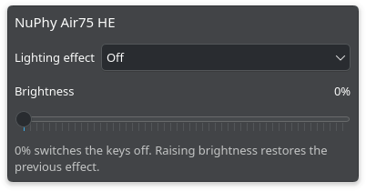
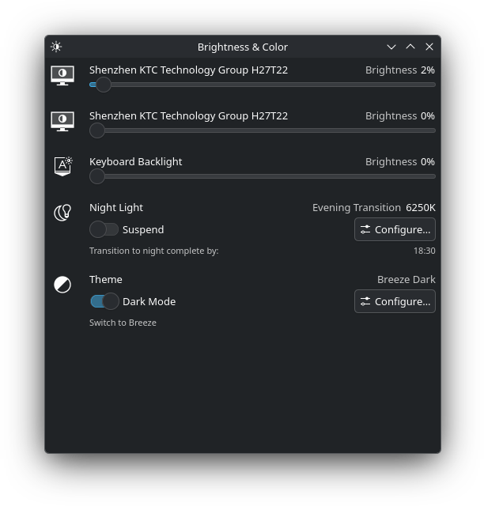

# NuPhy Air75 HE lighting for KDE

Control your keyboard's brightness and lighting effects from the KDE panel.
This adds a keyboard slider to **Brightness & Color** and an optional **NuPhy
Lighting** widget with an effects menu.

Works with the **Air75 HE over USB** (`19f5:6120`). Other NuPhy models aren't
supported yet.

## What it looks like

The NuPhy widget lets you choose effects such as Static, Breathing, Wave, and
Ripple, or turn the keys off.



You can also use the keyboard slider in KDE's usual Brightness & Color menu.



Screenshots taken on KDE Plasma 6.8.

## Install

You'll need Linux with KDE Plasma, systemd, a C compiler, `make`, `pkg-config`,
and the libsystemd development files. The optional widget needs **Plasma 6.8 or
newer**. Your kernel must support `uleds`; standard Arch/CachyOS kernels do.

On Arch or CachyOS, install the build tools:

```sh
sudo pacman -S --needed base-devel systemd
```

Connect the keyboard by USB and close NuPhyIO. From this project's directory:

```sh
make
sudo ./install.sh
systemctl --user restart plasma-powerdevil.service
```

Open **Brightness & Color** in your system tray. The keyboard slider should now
be there. The service starts automatically at boot.

To add the effects widget, run this **without sudo**:

```sh
./install-widget.sh
```

Right-click your panel, enter **Edit Mode**, choose **Add Widgets**, and add
**NuPhy Lighting**. Put it wherever you like on the panel.

## Using it

- **Brightness:** use either the NuPhy widget or KDE's keyboard slider.
- **Off:** set brightness to 0% or choose Off. Raising brightness restores your
  previous effect, even after a reboot.
- **Effects:** choose one from the widget's menu. Switching effects keeps the
  current brightness. If the keys are off, choosing an effect turns them on at 50%.
- **Side lights:** these controls only affect the keys. Side lighting is left alone.

The service remembers the previous effect separately for each keyboard profile.
If you connect a keyboard that's already off and there's no saved effect, it
uses Static when you raise the brightness.

You can unplug and reconnect the keyboard without restarting the service.
Brightness changes made while disconnected aren't saved for later.

Stop the service before using NuPhyIO so both programs don't send commands to
the keyboard at once:

```sh
sudo systemctl stop nuphy-backlight.service
# Use NuPhyIO, then close it.
sudo systemctl start nuphy-backlight.service
```

## Update

From the project directory, after getting the latest source:

```sh
make
sudo ./install.sh
systemctl --user restart plasma-powerdevil.service
./install-widget.sh
```

If you don't use the NuPhy widget, skip the last command.

## Uninstall

Remove the widget from your panel, then run:

```sh
sudo ./uninstall.sh
systemctl --user restart plasma-powerdevil.service
kpackagetool6 --type Plasma/Applet --remove local.nuphy.lighting
```

Skip the last command if you never installed the widget. The keyboard keeps its
last lighting setting. Saved effects remain in `/var/lib/nuphy-backlight/`.

## Development

```sh
make test          # Protocol, simulated keyboard, off/restore behavior
make test-widget   # QML controls talking to a mock D-Bus service
```

The service, widget, and off/restore behavior have also been used with a real
Air75 HE on KDE Plasma 6.8. Protocol notes and source references are in
[docs/protocol.md](docs/protocol.md).
